# Dynamic Island Pro – Comprehensive Visual Design & Architecture Specification

> **Reverse Engineered via REA (`morluto/rea`) Methodology**  
> **Source Target**: Dynamic Island Pro - Notch Bar (`tr.com.eywin.dynamic.island.notch`, Version 2.2.0 / `base.apk`)  
> **Decompilation Artifacts**: Complete DEX bytecode (`classes.dex` to `classes6.dex`), decompiled Jetpack Compose AST, XML Layouts, Vector Drawables, Values & Styles.

---

## 1. Executive Overview & Visual Philosophy

**Dynamic Island Pro** is an Android status bar & camera cutout overlay system designed to mimic and extend Apple's iOS Dynamic Island UX paradigm on arbitrary Android devices (punch-hole cameras, waterdrop notches, pill cutouts, and flat display top bezels).

### Core Architectural Pillars
1. **Window Overlay Layer**:
   * Uses Android `WindowManager` with `TYPE_APPLICATION_OVERLAY` (`2032`).
   * Flag configuration: `776` (`FLAG_NOT_FOCUSABLE | FLAG_NOT_TOUCH_MODAL | FLAG_LAYOUT_IN_SCREEN | FLAG_WATCH_OUTSIDE_TOUCH`).
   * PixelFormat: `TRANSLUCENT` (`-3`).
   * Base Gravity: `Gravity.TOP | Gravity.CENTER_HORIZONTAL` (`49`), dynamically updating to `Gravity.TOP | Gravity.START` (`8388659`) during interactive expansion and offset repositioning.
2. **Dual-Engine Rendering**:
   * **Base XML / View Hierarchy**: Used for hardware acceleration fallback, legacy layouts, and quick window sizing bounds (`fragment_notch.xml`, `item_medilayout.xml`, `notifiaction_item.xml`).
   * **Jetpack Compose Surface**: Main modern rendering pipeline hosted inside `ComposeView` (`bg2.b`, `le.g`, `le.h`, `le.n`), driven by an immutable reactive StateFlow state machine (`IslandStateManager`).

---

## 2. Window Layout & Geometric Coordinate System

The island's position and bounding geometry adapt smoothly to any screen resolution, physical cutout offset, and user calibration preferences.

### Base Dimensional Tokens
| Parameter | Default (dp/px) | Configuration Range | Stored Key | Notes |
| :--- | :--- | :--- | :--- | :--- |
| **Pill Width** | `240 px` | `100 px` – `800 px` | `overlay_width` | Autocalculated via `wj3.u0(context)` if unconfigured |
| **Pill Height** | `80 px` | `40 px` – `200 px` | `overlay_height` | Base collapsed pill height (`wj3.s0(context)`) |
| **Corner Radius** | `50 px` | `0 px` – `100 px` | `card_radius` | Pill capsule curvature (`wj3.t0(context)`) |
| **Top Margin (Y-Offset)** | `48 px` | `0 px` – `300 px` | `overlay_y_percent` | Percentage of screen height `(yPercent / 400.0) * screenHeight` |
| **Horizontal Offset (X-Shift)** | `0 px` | `-200 px` – `+200 px` | `overlay_x_percent` | Formula: `((screenWidth - width) / 2) + ((xPercent / 400.0) * screenWidth)` |
| **Custom Top-Left Radius** | `50 px` | `0` – `100` | `radiusLeftTop` | For asymmetric cutouts (e.g. corner punch hole) |
| **Custom Bottom-Left Radius** | `50 px` | `0` – `100` | `radiusLeftBottom` | |
| **Custom Top-Right Radius** | `50 px` | `0` – `100` | `radiusRightTop` | |
| **Custom Bottom-Right Radius** | `50 px` | `0` – `100` | `radiusRightBottom` | |

### Dynamic Window Resize Hook (`p84.java`)
Whenever Jetpack Compose recalculates layout contents (e.g. expanding from a small notification badge to a full media player), the Compose size callback propagates measured `DpSize` back to the Android `WindowManager`:
```java
float density = context.getResources().getDisplayMetrics().density;
int targetWidth = (int) (measuredDpWidth * density);
int targetHeight = (int) (measuredDpHeight * density);

int xPos = ((screenWidth - targetWidth) / 2) + ((int)((xPercent / 400.0) * screenWidth));
int yPos = (int)((yPercent / 400.0) * screenHeight);

layoutParams.width = targetWidth;
layoutParams.height = targetHeight;
layoutParams.gravity = Gravity.TOP | Gravity.START;
layoutParams.x = xPos;
layoutParams.y = yPos;
windowManager.updateViewLayout(overlayView, layoutParams);
```

---

## 3. The 16 Dynamic Island Visual States (`mp2` Machine)

The application models its visual states through a polymorphic state hierarchy managed by `IslandStateManager.kt`. Each state has dedicated layout composition, color treatments, iconography, and dismissal physics.

```mermaid
stateDiagram-v2
    [*] --> Idle: Default (ep2.a)
    Idle --> Charging: Plug Connected (ap2)
    Idle --> LowBattery: Battery <= 20% (gp2)
    Idle --> MusicCollapsed: Playback Active (hp2)
    MusicCollapsed --> MusicExpanded: Tap / Long Press (hp2.isExpanded)
    MusicExpanded --> MusicCollapsed: Minimize / Tap Outside
    Idle --> IncomingCall: Ringing (fp2)
    IncomingCall --> ActiveCall: Answer (zo2)
    ActiveCall --> Idle: End Call
    Idle --> Notification: Push Arrived (ip2)
    Idle --> FaceID: Biometric Request (dp2.a)
    Idle --> DeviceUnlocked: Unlock Event (bp2.a)
    Idle --> EarphoneConnected: Bluetooth Audio Connected (cp2)
    Idle --> SilentMode: Ringer Silent (kp2.a)
    Idle --> RingMode: Ringer Normal (jp2.a)
    Idle --> Timer: Active Countdown (lp2)
    Idle --> AirplaneMode: Toggle Airplane (wo2)
    Idle --> AskAI: AI Assistant (xo2)
    Idle --> AssistiveTouch: Floating Menu (yo2.a)
    Charging --> Idle: Auto-dismiss (2500ms)
    LowBattery --> Idle: Auto-dismiss (5000ms)
    Notification --> Idle: Auto-dismiss (3000ms)
    FaceID --> Idle: Auto-dismiss (1500ms)
    DeviceUnlocked --> Idle: Auto-dismiss (2000ms)
    EarphoneConnected --> Idle: Auto-dismiss (3000ms)
    SilentMode --> Idle: Auto-dismiss (2100ms)
    RingMode --> Idle: Auto-dismiss (2000ms)
    AirplaneMode --> Idle: Auto-dismiss (2000ms)
```



---

### 3.1 State Specifications & Visual Elements

#### State 1: Idle / Resting Notch (`ep2.a`)
* **Visual Form**: Compact black pill framing the physical hardware camera hole.
* **Dimensions**: Defined by user calibration (`overlay_width` x `overlay_height`).
* **Active Overlay Items**:
  * Optional **Notch Pet / Pixel Companion** (one of 39 animated pixel-art characters).
  * Optional glowing neon stroke border (`border_width`: 0.75dp–2.0dp).
* **Background**: OLED Pitch Black `#000000` or selected custom theme.

#### State 2: Battery Charging (`ap2`)
* **Trigger**: Battery charger connected (`ACTION_BATTERY_CHANGED`).
* **Auto-Dismiss**: `2500 ms`.
* **Visual Components**:
  * **Left Side**: String `"Charging"` (`15sp`, Medium weight, pure white `#FFFFFF`).
  * **Center**: Camera cutout clearance gap.
  * **Right Side**:
    * Numerical percentage (`"%d%%"`, e.g. `"85%"`), `15sp`, Bold weight (`s11.G()`).
    * **Lightning Bolt Battery Icon**: `16dp x 16dp`, vector path `J()`.
* **Color Psychology**:
  * Level `> 20%`: **Electric iOS Green** (`0xFF34C759` / `j31.c(4281648985L)`).
  * Level `<= 20%`: **Deep Orange Warning** (`0xFFFF5722` / `j31.c(4294953984L)`).
* **Animation Dynamics**:
  * Continuous alpha glow pulse: `alpha` animates between `0.5f` and `1.0f`.
  * Curve: `FastOutSlowInEasing` (`co1.d`), Duration: `800 ms`, Repeat: `Reverse`.
  * Pill container corners: `10dp` inner padding, `6dp` pill capsule.

#### State 3: Low Battery Warning (`gp2`)
* **Trigger**: Battery drops to `<= 20%` while unplugged.
* **Auto-Dismiss**: `5000 ms`.
* **Visual Components**:
  * **Left Side**: String `"Low Battery"` (`15sp`, Bold, `#FFFFFF`).
  * **Right Side**:
    * Battery percentage text (`15sp`, Bold, Amber Red `0xFFFF3B30` / `j31.c(4294916912L)`).
    * Low battery icon with red stroke (`20dp x 20dp`).

#### State 4: Device Unlocked (`bp2.a`)
* **Trigger**: Screen unlocked / keyguard dismissed.
* **Auto-Dismiss**: `2000 ms`.
* **Visual Components**:
  * Center animated Padlock glyph (`18dp x 18dp`).
  * Shackle unhooking spring motion:
    * `scale`: `1.0f` to `1.1f` bounce.
    * Spring damping ratio: `0.4f`, stiffness: `1000.0f` (`p17.F(0.4f, 1000.0f)`).
    * Alpha transition: `0.0f` -> `1.0f` with `600ms` fade.

#### State 5: FaceID / Biometric Unlock (`dp2.a`)
* **Trigger**: Biometric authentication requested.
* **Auto-Dismiss**: `1500 ms`.
* **Visual Components**:
  * FaceID vector icon: `64dp x 64dp` (`ut4.ic_faceid_custom`).
  * Interactive Color Morph:
    * Idle / Scanning: White `#FFFFFF`.
    * Success Match: Animates to iOS Green `0xFF34C759` within `300 ms` (`p17.J(300, 0, null, 6)`).
  * Scale bounce: Double-axis scale oscillation on authentication confirmation.

#### State 6: Bluetooth / Earphone Connection (`cp2`)
* **Trigger**: Bluetooth headset/audio sink connected (`BluetoothDevice.ACTION_ACL_CONNECTED`).
* **Auto-Dismiss**: `3000 ms`.
* **Visual Components**:
  * **Left Icon**: AirPods / Headphone glyph (`ut4.ic_airpods_custom`, `24dp x 24dp`) encased in a `28dp` circular pill with `0.1` white background.
  * **Center / Label**:
    * Top subtext: `"Connected"` (`12sp`, slate gray `#7D889B`).
    * Bottom title: Device Name (e.g. `"AirPods Pro"`, `15sp`, Bold `#FFFFFF`, max 1 line, ellipsize).
  * **Right Graphic**: Expanding concentric radar soundwave pulse (`ring` animation, 0.0 to 1.0 scale over `800 ms`).

#### State 7: Music / Audio Playback (`hp2`)
* **Collapsed Pill State**:
  * **Left**: Circular album art (`22dp x 22dp`, corner radius `4dp`). If no art: Music note vector (`14dp`).
  * **Right**: Real-time animated audio visualizer waveform:
    * 3–4 vertical bars oscillating with varying phase heights (`0xFF34C759` or accent color).
* **Expanded Island State (`le.n` & `item_medilayout.xml`)**:
  * Full width card: `0dp` with start/end margins of `8dp`. Top margin: `24dp`. Corner radius: `24dp`.
  * Album Art: Large high-resolution `48dp x 48dp` rounded thumbnail.
  * Typography:
    * Track Title: `16sp`, Bold, `#FFFFFF`, 1 line ellipsize.
    * Artist Name: `14sp`, Subtitle Slate `#7D889B`.
  * Seekbar Progress Bar:
    * Background Track: `0.75dp` height, `#1AFFFFFF` (10% translucent white), radius `5dp`.
    * Progress Track: `2.0dp` height, `#FFFFFF` pure white, radius `5dp`.
    * Thumb: Transparent / None (`thumb="@null"`).
    * Elapsed & Total Duration: `12sp`, monospace-styled time string (`MM:SS`).
  * Control Action Bar:
    * Previous Track: `48dp x 48dp` touch target (`@drawable/baseline_skip_previous_24`).
    * Play/Pause: `48dp x 48dp` center button (`baseline_pause_24` / `baseline_play_arrow_24`).
    * Next Track: `48dp x 48dp` touch target (`@drawable/baseline_skip_next_24`).
    * Close / Collapse Button: `32dp x 32dp` at top right (`baseline_close_24`).

#### State 8: Incoming Phone Call (`fp2`)
* **Trigger**: Telephony state `RINGING`.
* **Auto-Dismiss**: Stays active until answered or rejected.
* **Visual Components**:
  * **Caller Avatar**: `50dp` circular disc with color `0xFF007AFF`. Displays first initial letter (`22sp`, Bold `#FFFFFF`).
  * **Caller Information**:
    * Subtitle: `"Mobile"` (`12sp`, slate gray).
    * Title: Contact Name / Phone Number (`16sp`, Bold `#FFFFFF`).
  * **Action Buttons**:
    * **Reject Call Button**: `52dp x 52dp` circle, Red `#FF3B30` (`j31.c(4294916912L)`). Hangup icon `26dp` rotated.
    * **Accept Call Button**: `52dp x 52dp` circle, Green `#34C759` (`j31.c(4281648985L)`). Phone answer icon `26dp`.

#### State 9: Ongoing / Active Call (`zo2`)
* **Trigger**: Call answered / ongoing.
* **Auto-Dismiss**: Until call ended.
* **Visual Components**:
  * **Left Side**: Elapsed call timer (e.g. `"03:42"`), `14sp`, Bold Green (`0xFF34C759` / `j31.c(4283226468L)`).
  * **Center**: Audio waveform pulse indicator.
  * **Right Side Action Controls**:
    * **Speakerphone Toggle**: `24dp x 24dp` circular button. When ON: highlighted with `0.2` white tint; When OFF: transparent. Speaker icon `12dp`.
    * **End Call Button**: `24dp x 24dp` circular button, solid Red `#FF3B30`. Hangup icon `12dp`.

#### State 10: Push Notifications (`ip2`)
* **Trigger**: Notification received by `MyNotificationListenerService`.
* **Auto-Dismiss**: `3000 ms`.
* **Visual Components**:
  * **App Icon Container**: `38dp x 38dp` rounded square (`10dp` corner radius) with custom branded gradients:
    * **Instagram**: Linear gradient `0xFFF58529` -> `0xFFDD2A7B` -> `0xFF8134AF`.
    * **WhatsApp**: Linear gradient `0xFF25D366` -> `0xFF128C7E`.
    * **Default / System**: Linear gradient `0xFF007AFF` -> `0xFF0051A8`.
  * **Content**:
    * Top row: App Name (`12sp`, accent `#8E8E93`).
    * Message Title: `15sp`, Bold `#FFFFFF`, max 1 line with marquee / ellipsize.
    * Timestamp Badge: `"Now"` (`12sp`, `#8E8E93`).

#### State 11: Silent Mode (`kp2.a`)
* **Trigger**: System audio mode changed to `RINGER_MODE_SILENT` or `VIBRATE`.
* **Auto-Dismiss**: `2100 ms`.
* **Visual Components**:
  * **Icon**: Bell with diagonal slash (`ok2.y()`), Red `#FF3B30` (`j31.c(4294916912L)`).
  * **Shake Animation**: Bell oscillates rotation between `-15.0°` and `+15.0°` (`100ms` period, 4 cycles).
  * **Label**: `"Silent"` (`16sp`, Bold Red, `s11.G()`).

#### State 12: Ring / Sound Mode (`jp2.a`)
* **Trigger**: System audio mode switched to `RINGER_MODE_NORMAL`.
* **Auto-Dismiss**: `2000 ms`.
* **Visual Components**:
  * **Icon**: Ringing bell with soundwaves (`dk2.G()`), pure white `#FFFFFF`.
  * **Bounce Animation**: Vertical scale bounce (`njVar2`).
  * **Label**: `"Ring"` (`16sp`, Bold White, `s11.G()`).

#### State 13: Timer / Countdown (`lp2`)
* **Trigger**: System timer active.
* **Auto-Dismiss**: Stays until timer dismissed.
* **Visual Components**:
  * **Icon**: Stopwatch glyph (`zg2.u()`, `20dp`, `#FFFFFF`).
  * **Countdown Time**: Formatted remaining time (e.g. `"09:41"`), `16sp`, Bold `#FFFFFF`.

#### State 14: Airplane Mode (`wo2`)
* **Trigger**: Airplane mode toggled.
* **Auto-Dismiss**: `2000 ms`.
* **Visual Components**:
  * **Icon**: Airplane glyph (`ye3.j0()` / `wj3.q0()`, `22dp`, `#FFFFFF`).
  * **Label**: `"Airplane Mode On"` or `"Airplane Mode Off"` (`16sp`, Bold `#FFFFFF`).

#### State 15: Ask AI (`xo2`)
* **Trigger**: Tap on AI notch icon or gesture shortcut.
* **Visual Components**:
  * Expandable floating prompt capsule featuring glowing gradient halo.
  * Direct speech-to-text / AI query input field with micro-animations.

#### State 16: Assistive Touch (`yo2.a`)
* **Trigger**: Tap notch when `switch_assitive_notch` is enabled.
* **Visual Components**:
  * iOS-style multi-button floating launcher grid (`ut.a`).
  * Shortcuts for Screenshot, Lock Screen, Back, Home, Recents, Notifications, and Quick Settings.

---

## 4. Motion Design, Physics Curves & Interpolators

The animation architecture (`AnimationManager.kt`) uses physics-based spring models and custom Bezier easing to simulate iOS fluid dynamic rubber-band behavior.

### 4.1 Transition Specifications
| Transition | From State | To State | Duration | Interpolator / Curve | Physics Parameters |
| :--- | :--- | :--- | :--- | :--- | :--- |
| **Pill Expansion** | Collapsed Pill | Expanded Panel | `200 ms` | `FastOutSlowInInterpolator` | ValueAnimator width/height synchronized |
| **Media Card Entrance** | Hidden | Fully Visible | `450 ms` | `AccelerateDecelerateInterpolator` | `alpha: 0->1`, `translationY: -40->0`, `scale: 0.92->1.0` |
| **Media Card Exit** | Fully Visible | Hidden | `300 ms` | `DecelerateInterpolator` | `alpha: 1->0`, `scale: 1.0->0.6` |
| **Notification Pop-in** | Hidden | Visible | `500 ms` | `OvershootInterpolator(3.0f)` | `scale: 0.7->1.0` with extreme elastic overshoot bounce |
| **Notification Dismiss** | Visible | Swiped Up | `400 ms` | `DecelerateInterpolator` | `translationY: 0->-height`, `scale: 1.0->0.3`, `alpha: 1->0` |
| **Padlock Spring Bounce** | Locked | Unlocked | `600 ms` | Jetpack Spring | Damping: `0.4f`, Stiffness: `1000.0f` |
| **Bell Oscillation** | Rest | Ringing / Silent | `400 ms` | Sine Wave | `rotation: -15° <-> +15°`, 4 cycles |
| **Battery Alpha Pulse** | Normal | Glowing | `800 ms` | `FastOutSlowInEasing` | `alpha: 0.5f <-> 1.0f`, RepeatMode.Reverse |
| **Scale Up & Down (Pulse)**| Normal Pill | Accented Pulse | `duration` | `DecelerateInterpolator` | `scale: 1.0f -> 1.75f -> 1.0f`, corner radius scaled proportionally |

---

## 5. Touch Gestures & Action Mapping

User gestures on the notch overlay are detected by `GestureDetector` in `AnimationManager.kt` with tight tolerances:
* **Horizontal Swipe Threshold**: `40 px`
* **Velocity Threshold**: `40 px/s`
* **Touch Event Routing**:

| Gesture | Handler Method | Default Behavior | Configurable Actions (`SelectionManager`) |
| :--- | :--- | :--- | :--- |
| **Single Tap** | `onClick` | Expand Active State (e.g. open Music Player or Dismiss Assistive) | Open Camera, Power Menu, Flashlight, QR Scanner, Media Controller, Home, Back, Recents |
| **Long Press** | `onLongClick` | Launch configured Shortcut via `SelectionManager` | Open Application, Lock Screen, Toggle Flashlight, Open Notifications |
| **Swipe Left** | `onSwipeLeft` | Skip to Previous Track / Dismiss Notification | Bound to Media `skipToPrevious()` |
| **Swipe Right** | `onSwipeRight` | Skip to Next Track | Bound to Media `skipToNext()` |
| **Swipe Down** | `onSwipeDown` | Pull Down Android Notification Shade | Calls `AccessibilityService.performGlobalAction(GLOBAL_ACTION_NOTIFICATIONS)` |

---

## 6. Haptic Feedback Specifications
* **Keypress Haptic**: `performHapticFeedback(HapticFeedbackConstants.KEYBOARD_TAP)` (`1`) executed on standard pill tap / state toggle.
* **Confirm Haptic**: `performHapticFeedback(HapticFeedbackConstants.CONFIRM)` (`16`) executed on long-press trigger and AI assistant invocation.
