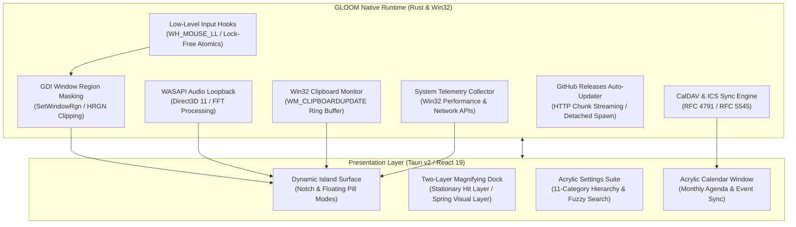

<div align="center">

  <picture>
    <source media="(prefers-color-scheme: dark)" srcset="assets/logo.svg">
    <source media="(prefers-color-scheme: light)" srcset="assets/logo-dark.svg">
    
  </picture>

  # GLOOM

  ### High-Performance Contextual Interaction Surface and Desktop Companion for Windows

  <p align="center">
    <a href="https://github.com/NandiVardhan2007/GLOOM/releases/latest"></a>
    <a href="https://github.com/NandiVardhan2007/GLOOM/actions/workflows/build.yml"></a>
    <a href="https://microsoft.com/windows"></a>
    <a href="https://tauri.app"></a>
    <a href="LICENSE"></a>
  </p>

  <p align="center">
    <a href="#overview">Overview</a> •
    <a href="#system-architecture">System Architecture</a> •
    <a href="#core-subsystems">Core Subsystems</a> •
    <a href="#surface-geometries">Surface Geometries</a> •
    <a href="#installation">Installation</a> •
    <a href="#building-from-source">Building from Source</a> •
    <a href="#license">License</a>
  </p>

</div>

---

## Overview

GLOOM is a lightweight, high-performance contextual interaction surface and desktop companion engineered for Windows 11 and Windows 10. Implemented on top of Tauri v2, Rust, Direct3D 11, and React 19, GLOOM introduces an adaptive Dynamic Island, a fluid magnifying desktop dock, and on-demand acrylic utility surfaces directly into the Windows Desktop Window Manager (DWM) composition pipeline.

Unlike conventional overlay utilities that capture full-screen input or inject intrusive hooks, GLOOM maintains hardware-level GDI window region masking (`SetWindowRgn`), lock-free low-level mouse hooks (`WH_MOUSE_LL`), and non-activating window styles (`WS_EX_NOACTIVATE`). This architecture guarantees full click and gesture pass-through across all non-rendered pixels while consuming negligible CPU cycles at idle.

---

## System Architecture



### Key Technical Characteristics

- **Direct3D 11 and GPU Rasterization**: Configured with low-level Chromium rasterization flags (`--enable-gpu-rasterization`, `--enable-zero-copy`, `--ignore-gpu-blocklist`) for hardware-accelerated SVG, blur, and layout compositing.
- **Lock-Free Atomic Input Processing**: Mouse coordinates and monitor boundaries are processed via atomic primitives (`AtomicI32`, `AtomicU32`, `AtomicBool`), preventing mutex contention within the 1000 Hz `WH_MOUSE_LL` hook.
- **Strict Bounded Region Clipping**: Dynamically synchronizes Win32 `HRGN` bounds with the active frontend capsule geometry. Outside areas pass clicks directly to desktop shortcuts, application windows, and taskbar icons.
- **Full-Screen Detection**: Monitors the active foreground window state via Win32 APIs, automatically suppressing overlay rendering when exclusive full-screen 3D games, presentations, or video players gain focus.

---

## Core Subsystems

### 1. Contextual Dynamic Island

The primary interaction surface anchors at the upper screen boundary, expanding dynamically to present glanceable telemetry and controls:

- **Media Subsystem**: Intercepts active playback sessions via Windows GSMTC (Global System Media Transport Controls) and captures output frequencies through WASAPI loopback. Features real-time HSL dominant color extraction, multi-mode visualizers (frequency bars, liquid wave, breathing aura), mouse wheel volume scrubbing, and fine-grained seek scrubbers.
- **Synced Lyrics Engine**: Employs a low-latency waterfall query engine. It prioritizes local stream title parsing to extract broadcast lyrics without network requests, falling back to a native Rust client querying LRCLIB endpoints (exact match, cleaned artist/title, search query). Categorizes lines into active, near, and distant visual tiers with automatic duration alignment.
- **Productivity Drawer**: Houses a Win32 clipboard history monitor listening to `WM_CLIPBOARDUPDATE`, maintaining an in-memory ring buffer with deduplication and JSON persistence. Includes a persistent scratchpad with auto-save and dynamic keyboard focus acquisition (`request_notch_keyboard_focus`) that temporarily toggles `WS_EX_NOACTIVATE` and returns focus upon blur.
- **System Telemetry**: Reads real-time hardware telemetry via `GetSystemTimes` (CPU load), `GlobalMemoryStatusEx` (physical and virtual RAM allocation), `GetDiskFreeSpaceExW` (storage capacity), and `GetIfTable2` (network interface throughput).
- **Control Center**: Provides quick toggles for Wi-Fi network scanning, Bluetooth peripheral enumeration, per-app Core Audio session volume sliders, display brightness, and system power actions.
- **Toast Notifications**: Receives system notifications via WinRT `UserNotificationListener`, extracting application identity and body text from adaptive visual trees to present non-intrusive alert banners.
- **Live Activity Tracking**: Monitors active downloads across supported web browsers using a file-system directory watcher, displaying real-time transfer progress.

### 2. Fluid Magnifying Desktop Dock

A standalone, macOS-inspired application dock optimized for multi-monitor Windows environments:

- **Two-Layer Architecture**: Decouples the stationary Hit Layer (fixed slots that never shift or reflow) from the animated Visual Layer (continuous parabolic magnification governed by harmonic spring physics: `stiffness: 400`, `damping: 28`, `mass: 0.6`). This eliminates hover jitter and visual feedback loops.
- **High-Density Scaling**: Automatically activates scale and X-offset GPU transforms when the dock exceeds 15 items, maintaining 60+ FPS layout stability without DOM reflow penalties.
- **Taskbar Synchronization**: Imports Windows taskbar pinned applications via `IShellLinkW` COM interfaces and integrates clean autostart management without registry bloat.

### 3. Multi-Window Acrylic Utility Suite

GLOOM instantiates secondary utility windows on demand, preserving system memory when windows are closed:

- **Calendar Surface (`calendar.html`)**: Monthly agenda and event schedule powered by native Rust CalDAV and RFC 5545 ICS parsing engines (`caldav.rs`, `ics.rs`, `calendar_sync.rs`). Supports iCloud, Google Calendar, Fastmail, Nextcloud, and custom WebCal feeds with Windows Credential Manager authentication storage.
- **Settings Hierarchy (`settings.html`)**: Comprehensive 11-category configuration interface (General, Appearance, Notch, Dock, Overlays, Calendar Sync, Agent Intro, Agent Sounds, Diagnostics, Processes, About). Powered by an in-memory fuzzy search index providing deep-linking directly to specific setting rows.
- **Materials**: Leverages native Windows 11 Acrylic and Mica compositor materials, adapting contrast dynamically for light and dark system color schemes.

### 4. Installer and Deployment Pipeline

- **Self-Contained Setup Wizard (`installer-app/`)**: A native Tauri v2 installer executable (`GLOOM-Setup.exe`) embedding the compressed release payload via `include_bytes!`. Features install path selection, UAC privilege elevation handling (`runas`), desktop and Start Menu shortcut generation via COM interfaces, and Add/Remove Programs registry registration.
- **Resilient Auto-Updater**: Directly queries GitHub Releases API with automated failover to raw manifest endpoints. Streams downloads in HTTP chunks with live percentage and byte telemetry, executing silent detached updates via `CREATE_BREAKAWAY_FROM_JOB`.

---

## Surface Geometries

GLOOM supports two primary geometry configurations:

| Parameter | Bezel Notch Mode (Default) | Floating Pill Mode |
| :--- | :--- | :--- |
| **Placement** | Anchored flush to screen upper bezel (`Y = 0`) | Floating capsule offset below edge (`Y = 10px`) |
| **Edge Geometry** | C1-continuous cubic-bezier concave shoulder flares | Continuous squircle capsule (`22px` resting, `34–38px` expanded) |
| **Target Setup** | Displays with upper bezels or laptop screens | Centered multi-monitor, ultrawide, and clean desktop setups |
| **Resting Dimensions** | Adaptive width x 34px height | 180px width x 36px height |
| **Input Masking** | Bounded `SetWindowRgn` clipping; click pass-through | Bounded `SetWindowRgn` clipping; click pass-through |

---

## Technical Specifications

| Layer | Technologies | Role in System |
| :--- | :--- | :--- |
| **Backend Runtime** | Rust (2021/2024 edition), Tauri v2 | Low-level OS integration, IPC dispatch, multi-threading, memory safety |
| **Windows APIs** | Win32, Direct3D 11, DWM, WASAPI, WinRT | Window clipping, input hooks, audio loopback, notifications, COM shortcuts |
| **Frontend UI** | React 19, TypeScript, CSS Variables | Component state management, segmented surface routing, DOM rendering |
| **Animation Engine** | Framer Motion, CSS Transforms | Harmonic spring physics, layout animations, GPU layer promotion |
| **Web Runtime** | Microsoft Edge WebView2 (Evergreen) | Hardware-accelerated Chromium rendering host |
| **Calendar Protocol** | CalDAV (RFC 4791), ICS (RFC 5545) | Bi-directional calendar synchronization and schedule caching |
| **Lyrics Protocol** | LRCLIB REST API, Local GSMTC Streams | Synchronized lyrics retrieval, time-code alignment |

---

## System Requirements

- **Operating System**: Windows 11 (64-bit) or Windows 10 (version 1903 or later, 64-bit)
- **Web Runtime**: Microsoft Edge WebView2 Evergreen Runtime (included with Windows 11 and modern Windows 10 installations)
- **Graphics**: Direct3D 11 capable graphics hardware
- **Storage**: Approximately 120 MB free disk space

---

## Installation

### Method 1: Graphical Setup Wizard

1. Download **[`GLOOM-Setup.exe`](https://github.com/NandiVardhan2007/GLOOM/releases/latest)** from the latest release.
2. Execute the setup binary to install GLOOM. The wizard registers desktop shortcuts, Start Menu integration, and the system uninstaller.

### Method 2: PowerShell Unattended Installation

Run the following command in PowerShell:

```powershell
irm https://raw.githubusercontent.com/NandiVardhan2007/GLOOM/main/scripts/install.ps1 | iex
```

### Uninstallation

To remove GLOOM along with all cached configurations and shortcuts:

```powershell
irm https://raw.githubusercontent.com/NandiVardhan2007/GLOOM/main/scripts/uninstall.ps1 | iex
```

Alternatively, launch `uninstall.exe` located within the application install directory or uninstall via **Windows Settings > Installed apps**.

---

## Building from Source

### Prerequisites

- **Node.js**: v20 LTS or v22 LTS
- **Rust Toolchain**: Stable channel (`rustup update stable`)
- **Build Tools**: Visual Studio C++ Build Tools with the "Desktop development with C++" workload

### Compilation Steps

```powershell
# 1. Clone repository
git clone https://github.com/NandiVardhan2007/GLOOM.git
cd GLOOM

# 2. Compile desktop application
cd Desktop
npm install
npm test
npm run tauri build -- --no-bundle

# 3. Package release binary and compile custom installer
cd ..
Compress-Archive -Path Desktop/src-tauri/target/release/gloom.exe -DestinationPath installer-app/src-tauri/payload.zip -Force
cd installer-app
npm install
npm run tauri build -- --no-bundle

# Output executable is located at:
# installer-app/src-tauri/target/release/gloom-installer.exe (GLOOM-Setup.exe)
```

### Automated Verification

Before submitting changes, run the test suites across both frontend and backend layers:

```powershell
# Run frontend unit tests (38 tests across 8 suites)
npm test --prefix Desktop

# Run backend Rust unit tests (44 unit tests)
cargo test --manifest-path Desktop/src-tauri/Cargo.toml
```

---

## Repository Structure

```
GLOOM/
├── .github/                  # CI/CD workflows and repository funding metadata
├── assets/                   # Vector SVG brand assets (adaptive dark/light)
├── Desktop/                  # Primary desktop application workspace
│   ├── src/                  # React 19 frontend (Dynamic Island, Dock, Settings, Calendar)
│   │   ├── components/       # DynamicIsland, Dock, ProductivityDrawer, Navigation
│   │   ├── hooks/            # Lyrics synchronization, media, telemetry hooks
│   │   ├── icons/            # SVG system icons
│   │   └── settings/         # 11-category settings tabs and fuzzy search engine
│   └── src-tauri/            # Rust native backend
│       └── src/              # Win32 services, Direct3D, WASAPI, CalDAV, updater
├── installer/                # Native NSIS fallback packaging assets
├── installer-app/            # Standalone Tauri v2 setup wizard and uninstaller
├── scripts/                  # Automated build, installation, and release scripts
└── tests/                    # Integration, IPC contract, and geometry test suites
```

---

## Sponsorship

GLOOM is maintained as an independent open-source project. If GLOOM enhances your daily workflow or desktop productivity, contributions to support ongoing development are welcome:

- **UPI (India and Global UPI)**: `7337419275-2@ybl` ([Direct UPI Link](upi://pay?pa=7337419275-2@ybl&pn=GLOOM&cu=INR))
- **Web QR Portal**: [https://upiqr.in/payment?pa=7337419275-2@ybl](https://upiqr.in/payment?pa=7337419275-2@ybl)

---

## License

This project is licensed under the terms of the [MIT License](LICENSE).

```
Copyright (c) 2026 GLOOM Contributors
```
