<div align="center">

  

  # G L O O M

  ### Next-Generation Dynamic Island & macOS Genie Dock Ecosystem
  **A seamless, glanceable activity surface & fluid desktop dock crafted for Windows 11/10 and Android**

  <p align="center">
    <a href="https://github.com/NandiVardhan2007/GLOOM/releases/latest"></a>
    <a href="https://github.com/NandiVardhan2007/GLOOM/actions/workflows/build.yml"></a>
    <a href="https://microsoft.com/windows"></a>
    <a href="https://developer.android.com"></a>
    <a href="https://tauri.app"></a>
    <a href="https://developer.android.com/jetpack/compose"></a>
    <a href="LICENSE"></a>
  </p>

  <p align="center">
    <a href="#-what-is-gloom">What is GLOOM</a> •
    <a href="#-key-features">Features</a> •
    <a href="#-macos-genie-dock-effect">Genie Effect</a> •
    <a href="#-dual-island-styles-notch--pill">Island Styles</a> •
    <a href="#-livebridge-continuity">LiveBridge</a> •
    <a href="#-installation--quickstart">Install</a> •
    <a href="#-support--sponsorship">Sponsor</a>
  </p>

</div>

---

## ⚡ What is GLOOM?

**GLOOM** reimagines how you interact with ongoing tasks, media, system metrics, and cross-device continuity. Blending the fluid elegance of Apple's **Dynamic Island** with the tactile nostalgia of the iconic **macOS Genie Effect Dock**, GLOOM lives unobtrusively at the periphery of your workspace — expanding when needed and melting into the bezel when idle.

Whether on your dual-monitor Windows workstation or your Android smartphone, GLOOM maintains unified physics, instant TLS-encrypted universal clipboard and file beams, and local offline AI tools.

> [!NOTE]
> **Independent Implementation**: GLOOM is an independent, cross-platform overlay suite engineered in Rust, Tauri, React 19, and Kotlin. It does not utilize Apple proprietary code or require iOS.

---

## 🌟 Key Features

<table>
  <tr>
    <td width="50%">
      <h3 align="center">🖥️ Windows Desktop Suite</h3>
      <ul>
        <li><b>macOS Genie Dock Effect</b>: True 50-slice cubic-bezier mesh deformation that fluidly funnels minimized windows into their dock icon.</li>
        <li><b>Notch & Pill Topologies</b>: Switch between a classic floating squircle pill and a MacBook-style flush bezel notch with concave shoulder curves.</li>
        <li><b>Layered Pass-Through Architecture</b>: Transparent topmost overlay (<code>WS_EX_LAYERED</code>) with pixel-accurate click-through detection.</li>
        <li><b>Fullscreen Intelligence</b>: Auto-suppresses when full-screen 3D games, presentations, or video players gain focus.</li>
        <li><b>Glanceable System Hub</b>: Live CPU/RAM telemetry, media controller, volume mixer, quick Wi-Fi picker, and weather forecast.</li>
      </ul>
    </td>
    <td width="50%">
      <h3 align="center">📱 Android Mobile Overlay</h3>
      <ul>
        <li><b>Cutout-Aware Alignment</b>: Dynamically queries <code>WindowInsets.DisplayCutout</code> to wrap flush around center punch-holes, corner cameras, and teardrops.</li>
        <li><b>Zero-Gap Top Bezel Anchor</b>: Anchors cleanly against the top screen edge with subpixel overbleed, eliminating awkward status bar gaps.</li>
        <li><b>Hands-On Mobile Automation</b>: Deterministic, accessibility-driven automation for WhatsApp, Instagram reels, pattern unlock, and Chrome form filling.</li>
        <li><b>Offline Tool Caller (Needle-3)</b>: Quantized Cactus-3 model asset with sub-25ms grammar-constrained local intent prediction.</li>
        <li><b>Cloud API Vault</b>: Hardware-backed AES-256-GCM Keystore vault for multi-key Groq, OpenRouter, and Gemini rotation.</li>
      </ul>
    </td>
  </tr>
</table>

---

## 🧞 macOS Genie Dock Effect

GLOOM brings the classic macOS **Genie Minimize & Restore Effect** to Windows:

```
    ┌────────────────────────┐
    │     Desktop Window     │
    │   ┌────────────────┐   │
    └───┼────────────────┼───┘
         \              /       ◄── 50-slice cubic-bezier deformation
          \            /        ◄── Asymmetric pinch towards active dock target
           \          /
            │        │
           ┌┴────────┴┐
           │ Dock App │         ◄── Window funnels seamlessly into icon
           └──────────┘
```

- **50-Slice Canvas Mesh Deformation**: Smooth, GPU-accelerated canvas slicing with cubic-bezier horizontal warping (`t³(1-t)`) and vertical acceleration.
- **Dynamic Dock Targeting**: Calculates the precise bounding rectangle of the target application icon on the GLOOM dock or Windows taskbar.
- **Customizable Dynamics**: Configure animation duration (150ms–800ms), curve intensity, and toggle between Genie and classic Scale transitions.

---

## 🎨 Dual Island Styles: Notch & Pill

GLOOM adapts to your personal aesthetic with two distinct primary geometries:

```
       [ CLASSIC FLOATING PILL ]                    [ FLUSH BEZEL NOTCH ]
       
   ┌───────────────────────────────┐           ─────────────────────────────────
   │                               │           ───────┐                 ┌───────
   │       (  GLOOM ISLAND  )      │                   \   GLOOM NOTCH   /
   │                               │                    └───────────────┘
```

1. **Floating Pill Mode**:
   - Compact `180×37 px` or standard `230×37 px` capsule floating gracefully below the top bezel.
   - Ideal for centered multi-monitor setups and standard phone cutouts.
2. **Bezel Notch Mode**:
   - Anchored directly at `Y = 0` with zero gap.
   - Features **C1-continuous cubic-bezier concave shoulder flares** on both sides, mimicking modern MacBook and high-end smartphone display hardware.

---

## 🌉 LiveBridge: Zero-Cloud Cross-Device Continuity

Work seamlessly across your PC and mobile device with peer-to-peer authenticated synchronization:

```mermaid
sequenceDiagram
    autonumber
    participant D as GLOOM Desktop (Win11)
    participant M as GLOOM Mobile (Android)

    Note over D,M: Local Subnet Discovery & Mutual TLS (Port 53391)
    D->>M: Authenticated Handshake (X-Gloom-Auth-Token + Nonce)
    M-->>D: 200 OK (Certificate Verified)
    
    rect rgb(18, 24, 38)
    Note over D,M: Universal Clipboard Sync
    D->>M: Push Encrypted Clipboard Payload
    M->>M: Update System Clipboard Buffer
    end

    rect rgb(28, 20, 36)
    Note over D,M: LAN File Beam (Chunked Streaming)
    D->>M: Stream File Chunk (SHA-256 Validated)
    M->>M: Write atomically to Downloads/
    M-->>D: Transfer Completed Badge
    end
```



- **Zero Third-Party Relays**: Direct local TCP socket with self-signed certificate pinning (`rustls`).
- **Replay Protection**: Enforces sliding-window nonces and strict 60-second timestamp validation.
- **Universal Clipboard**: Copies on desktop instantly reflect on Android without cloud leaks.
- **LAN File Beam**: High-speed streaming verified on-the-fly against SHA-256 checksums.

---

## 📐 Presentation State Architecture

GLOOM coordinates across 13 presentation states:

| State | Purpose | Desktop Presentation | Android Presentation |
|:---|:---|:---|:---|
| `idle` | Ambient standby | 230×37 px pill / notch | 180×37 dp pill / notch |
| `peek` | Transient notification (2.5s) | 400×180 px card with audio/app info | 400×180 dp card previewing alert/OTP |
| `minimal` | Secondary multitasking badge | Collapsed auxiliary wing | Detached satellite bubble |
| `expandedActivity` | Interactive controls | 400×180 px glass panel | 400×180 dp card with controls |
| `expandedControl` | Full system hub | Multi-tab dashboard & settings | Quick settings & sliders |
| `suppressed` | Fullscreen game / landscape | 0-opacity, zero hit-test capture | Auto-hidden during landscape |

---

## 📁 Repository Structure

The codebase is organized into clean, dedicated workspaces:

```
GLOOM/
├── Desktop/                  # Windows Desktop Tauri Workspace
│   ├── src/                  # React 19 + TypeScript Frontend
│   │   ├── components/       # DynamicIsland, GenieEffect, QuickPanel, EdgeSurface
│   │   ├── settings/         # Appearance, Dock, Notch, General tabs
│   │   └── hooks/            # LiveBridge & Telemetry hooks
│   └── src-tauri/            # Rust Backend (Win32 APIs, rustls bridge, system hooks)
│       └── src/              # window_effects, bridge, audio, monitors
├── Android/                  # Android Overlay & Agent Workspace
│   └── app/src/main/kotlin/  # Kotlin + Jetpack Compose
│       └── com/gloom/island/ # OverlayService, CutoutDetector, AiPlanner, SecureKeyStore
├── installer/                # Inno Setup Windows Installer Configuration
├── scripts/                  # Semantic version stamping and release utilities
└── tests/                    # Plain Python schema and protocol verification tests
```

---

## 🛠️ Installation & Quickstart

### ⚡ One-Line Quick Install

#### 🪟 Windows (PowerShell)
Open PowerShell (Terminal) and run the official one-liner to download, install, and launch GLOOM automatically:

```powershell
irm https://raw.githubusercontent.com/NandiVardhan2007/GLOOM/main/scripts/install.ps1 | iex
```

> [!TIP]
> **Silent / Unattended Install**: For headless setup or script deployment:
> ```powershell
> powershell -ExecutionPolicy Bypass -c "irm https://github.com/NandiVardhan2007/GLOOM/releases/latest/download/GLOOM-Island-Setup.exe -OutFile $env:TEMP\GLOOM-Island-Setup.exe; Start-Process $env:TEMP\GLOOM-Island-Setup.exe -ArgumentList '/VERYSILENT /NORESTART /SP-' -Wait; Start-Process (Join-Path $env:LOCALAPPDATA 'Programs\GLOOM\GLOOM.exe')"
> ```

#### 🤖 Android (via ADB)
Connect your device with USB debugging enabled and run:

```powershell
# Windows PowerShell
irm https://github.com/NandiVardhan2007/GLOOM/releases/latest/download/GLOOM-Island-Release.apk -OutFile $env:TEMP\gloom.apk; adb install -r $env:TEMP\gloom.apk
```
```bash
# macOS / Linux Bash
curl -sL "https://github.com/NandiVardhan2007/GLOOM/releases/latest/download/GLOOM-Island-Release.apk" -o /tmp/gloom.apk && adb install -r /tmp/gloom.apk && rm /tmp/gloom.apk
```

---

### 📦 Manual Download (Pre-Compiled Binaries)
Grab verified release assets directly from GitHub Releases:
- **Windows**: Download [`GLOOM-Island-Setup.exe`](https://github.com/NandiVardhan2007/GLOOM/releases/latest) (Includes Start Menu shortcuts, auto-updater & clean uninstaller).
- **Android**: Download [`GLOOM-Island-Release.apk`](https://github.com/NandiVardhan2007/GLOOM/releases/latest).

---

### 🔨 Building from Source

#### Prerequisites
- **Node.js**: v20 or v22
- **Rust Toolchain**: Stable (`rustup update stable`)
- **Android SDK**: API 35 / JDK 17
- **Inno Setup 6** (for building the Windows installer wizard)

#### Desktop (Windows)
```powershell
# 1. Install dependencies
cd Desktop
npm install

# 2. Run in development mode
npm run tauri dev

# 3. Compile production binary
npm run build
cargo build --release --manifest-path src-tauri/Cargo.toml

# 4. Generate official Inno Setup installer
iscc ../installer/gloom.iss
```

#### Mobile (Android)
```bash
# 1. Navigate to Android workspace
cd Android

# 2. Run unit test suite
./gradlew testDebugUnitTest

# 3. Assemble debug APK
./gradlew assembleDebug

# 4. Install directly to connected device via ADB
adb install -r app/build/outputs/apk/debug/app-debug.apk
```

---

## 💖 Support & Sponsorship

GLOOM is free and open-source software built with passion. If GLOOM enhances your daily workflow, consider sponsoring the project to support continuous development, hardware testing, and server infrastructure!

<div align="center">

### 🇮🇳 UPI Support (India & Global UPI)

Scan or send via any UPI application (Google Pay, PhonePe, Paytm, BHIM):

```
┌──────────────────────────────────────────┐
│                                          │
│   UPI ID:  7337419275-2@ybl              │
│   Name:    GLOOM Development Project     │
│                                          │
└──────────────────────────────────────────┘
```

<a href="upi://pay?pa=7337419275-2@ybl&pn=GLOOM&cu=INR">
  
</a>

</div>

---

## 📄 License

This repository is licensed under the terms of the **[MIT License](LICENSE)**.

```
Copyright (c) 2026 GLOOM Ecosystem Contributors
```
